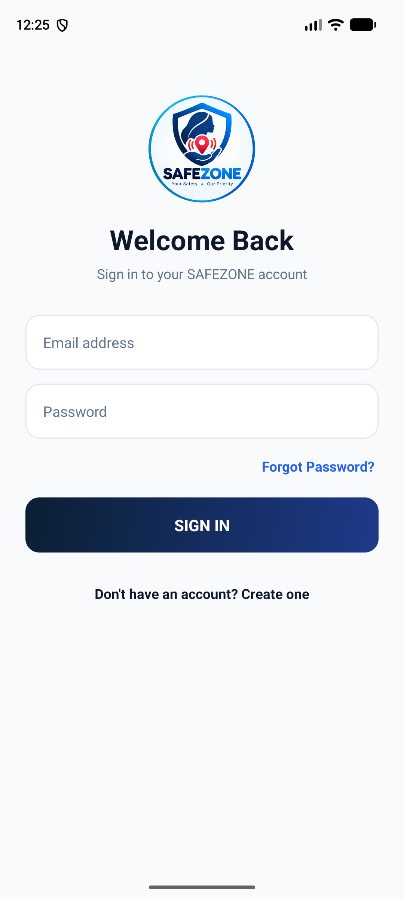
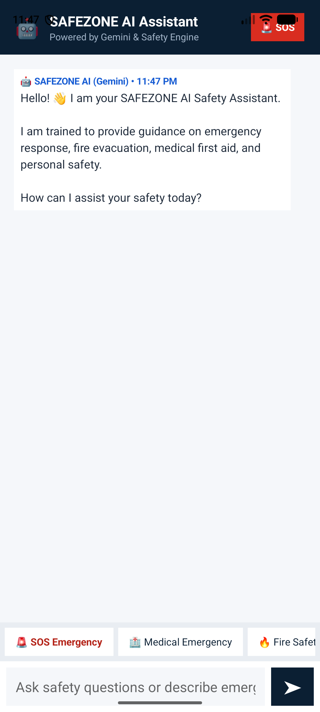
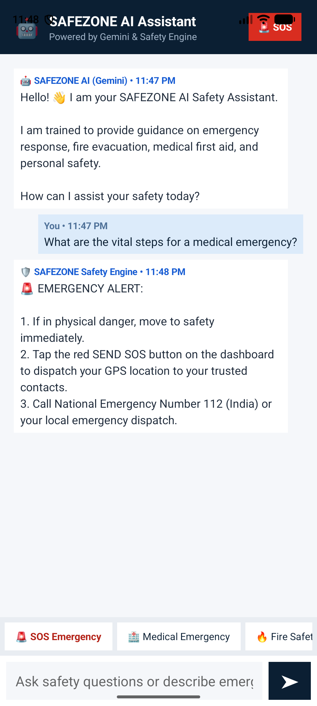
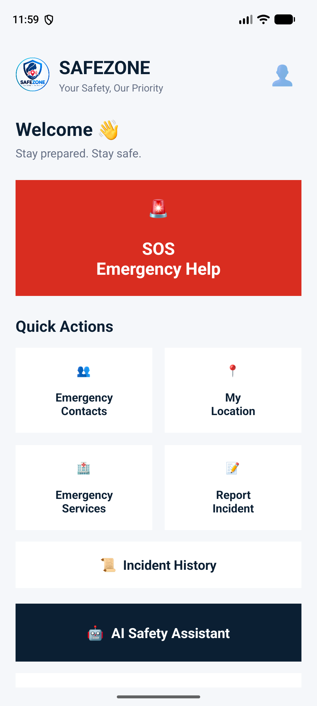

# 🛡️ SafeZone — Personal Emergency & Safety Assistant

**SafeZone** is an Android personal safety and emergency response application designed to help users quickly alert trusted contacts, share live GPS coordinates, contact emergency services, log safety incidents, and get instant crisis guidance powered by **Google Gemini AI** and **Firebase**.

---

## ✨ Key Features

- 🚨 **One-Tap SOS Alert:** Quickly send emergency SMS alerts with live GPS location links to saved trusted contacts.
- 🤖 **AI Safety Assistant (Gemini AI):** Real-time emergency guidance for medical crises, fire evacuation, personal threats, and first aid, with an automatic offline rule-based safety fallback.
- 📞 **Emergency Contacts Manager:** Add, manage, and quickly reach trusted family members and friends.
- 📍 **Live Location & Map Sharing:** View current GPS coordinates and share location links directly.
- 🚓 **Quick Emergency Helplines:** Instant dialing for National Emergency (`112`), Police (`100`), Fire (`101`), Ambulance (`108`), and Women's Helpline (`1091`).
- 📝 **Incident Reporting & History:** Report safety incidents with descriptions and timestamps, synced with Firebase Cloud Firestore & Storage.
- 💡 **Safety Tips & Guidelines:** Curated safety protocols for travel, night safety, cyber safety, and emergency preparedness.
- 🔐 **Secure User Authentication & Profile:** Powered by Firebase Authentication and Cloud Firestore.

---

## 📱 Screenshots

| Dashboard | AI Safety Assistant | AI Chat Response | Profile |
| :---: | :---: | :---: | :---: |
|  |  |  |  |

---

## 🛠️ Tech Stack

- **Languages:** Java & Kotlin
- **UI:** XML Layouts & Material Design Components
- **Backend & Cloud:**
  - Firebase Authentication
  - Firebase Cloud Firestore
  - Firebase Cloud Storage
  - Firebase App Check
- **AI Integration:** Google Gemini API (`gemini-2.5-flash` / REST API + Firebase AI Logic + Offline Safety Engine Fallback)
- **Build System:** Gradle (Kotlin DSL)

---

## 🚀 Getting Started / Setup Instructions

### 1. Clone the Repository
```bash
git clone https://github.com/AnushkaIngole20/SafeZone.git
cd SafeZone
```

### 2. Open in Android Studio
1. Open **Android Studio** and select **Open**.
2. Choose the cloned `SafeZone` folder and wait for Gradle to sync.

### 3. Configure Gemini API Key (Optional for AI Chat)
Add your Google AI Studio Gemini API Key to your local `local.properties` file (which is ignored by Git for security):

```properties
GEMINI_API_KEY=your_gemini_api_key_here
```
*(Alternatively, you can paste your Gemini API key directly inside the app by opening **AI Assistant** and tapping the **API Key** button).*

### 4. Build & Run
Select an Android Emulator or physical Android device (API 24+) and click **Run (▶)** in Android Studio.

---

## 🔒 Permissions Used

- `ACCESS_FINE_LOCATION` / `ACCESS_COARSE_LOCATION` — To fetch GPS coordinates during SOS alerts and location sharing.
- `SEND_SMS` — To dispatch automated emergency SOS text messages to trusted contacts.
- `CALL_PHONE` — For one-tap dialing to emergency helpline numbers.
- `POST_NOTIFICATIONS` — For safety alerts and status notifications.
